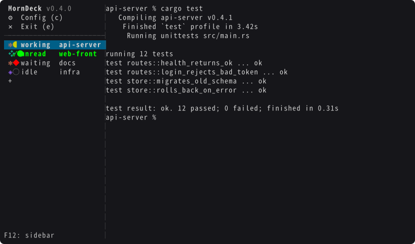

# MornDeck

[English](README.md) | 日本語

MornDeck は、ターミナル内で動作するタブ型のターミナルです。サイドバーに AI エージェントの状態を出します。macOS 11 以降 (Apple Silicon / Intel) で動きます。画面とメッセージは英語です。



## 特徴

- ひとつの端末の中にタブをいくつも作り、サイドバーで切り替えられます。
- 端末を閉じてもプロセスは動き続けます。`mdeck` を開き直せば、ssh からでも同じ画面に戻れます。
- AI 向けの API と MCP があり、タブを開く・文字を送る・画面を読む・返事を待つ、が外からできます。
- Claude Code・Codex CLI・GitHub Copilot CLI (以下 claude・codex・copilot) の状態 (作業中・入力待ち・完了) をサイドバーに出します。完了は通知音・ポップアップ・Webhook で知らせられます (どれも既定はオフ)。

## インストール

```bash
brew install --cask tsukumistudio/tap/morndeck
```

`mdeck` という名前のツールはほかにもあります (crates.io・npm・PyPI の Markdown スライドツールなど)。MornDeck とは別物なので、tap 名 (`tsukumistudio/tap`) を付けて入れてください。同じ名前のコマンドを両方入れることはできません。

更新は設定の「Check for updates」で行います。サーバーも新しい版で起動し直します。`brew upgrade --cask morndeck` だけで更新したときは、`mdeck restart` を実行するまで古い版のサーバーが動き続けます。どちらの場合もタブは戻り、エージェントは会話を再開します。

## はじめかた

1. `mdeck` で開きます。
2. `F12` → `c` で設定 (画面では「Config」) を開き、「Hooks」で使うエージェントを選んで `Enter` を押します。
3. タブの中で `claude` などを起動します。

## 基本操作

`F12` (fn+F12) でサイドバーのメニューを開きます。`↑` `↓` (または `k` `j`) で選び、`Enter` で決定するのが基本です。開いているものは、もう一度 `F12` で閉じます。

| キー | 動き |
| --- | --- |
| `↑` `↓` | タブを選ぶ (選んでいる間、そのタブが表示される) |
| `Enter` | 選んだタブに戻る。「Config」「Exit」「+」を選んでいれば、それを実行 |
| `c` | 設定 (Config) |
| `e` | 画面を閉じる (Exit。タブとサーバーは動いたまま) |
| `F12` | メニューを閉じる |

新しいタブは、タブの一覧の最後の「+」から開きます。マウスでも操作できます (タブのクリックで切り替え、サイドバーの境目のドラッグで幅を変える、タブの中でスクロール)。

設定では、更新・フックの導入と解除・サイドバーの幅・使用量のゲージ・通知音とポップアップ・通知先 (Webhook) を変えられます。「Test sound and popup」は実際にテストの通知を出します。通知先を選ぶと「Edit」「Test」「Delete」が出るので、`←` `→` で選んで `Enter` を押します。「Test」はその通知先だけにテストを送り、「Delete」は消す前にもう一度確かめます。

## タブ操作

> **タブの設定を変えるには、`F12` を押してタブを選び、`→` (右矢印) を押します。** `Enter` はそのタブに戻るだけで、タブのメニューは `→` で開きます。タブの右クリックでも開きます。

タブのメニューでできること:

| 項目 | 変え方 |
| --- | --- |
| 名前 (Name) | `Enter` → 入力 → `Enter` (空にすると外す) |
| Webhook (`owner`) | `←` `→` |
| AutoYes | `←` `→` |
| タブを削除 (Delete tab) | `Enter` → 「Delete」を選ぶ |

`mdeck kill` でサーバーとすべてのタブを止めます。タブの一覧は保存され、次に `mdeck` を開くと戻ります。`mdeck restart` はこの 2 つを続けて行います。

## フック

状態は各エージェントのフックで受け取ります。設定 (`F12` → `c` → Hooks で各エージェントの行の `Enter`) で入れます。claude はコマンドの `mdeck hooks install` でも入れられます。

| エージェント | 入れる場所 |
| --- | --- |
| claude | Claude Code のプラグイン `mdeck@mdeck` (`~/.mdeck/claude-plugin` から入れる) |
| codex | `~/.codex/hooks.json` (`CODEX_HOME` があれば `$CODEX_HOME/hooks.json`) |
| copilot | `~/.copilot/hooks/mdeck.json` (MornDeck 専用) |

- claude は、mdeck が `claude plugin` を実行してプラグインを入れます。Claude Code はそれを `settings.json` (`enabledPlugins` と、`~/.mdeck/claude-plugin` のパスを書いた `extraKnownMarketplaces`) と `~/.claude/plugins/` に記録し、プラグインは `~/.mdeck/claude-plugin` からその場で読みます。`settings.json` をほかのマシンと同期している場合は `mdeck hooks settings` も検討してください。入れられないとき (`claude` コマンドが無い、組織がマーケットプレイスを制限している、など) は、代わりに `~/.claude/settings.json` (`CLAUDE_CONFIG_DIR` があれば `$CLAUDE_CONFIG_DIR/settings.json`) に書き、理由を表示します。理由は `mdeck doctor` でも表示し、サーバーは起動のたびにやり直しはしません。
- `mdeck hooks settings` (設定の Claude Code の行では `s`) で、プラグインの代わりに `settings.json` を使います。この選択は残ります。`mdeck hooks plugin` (`p`) でプラグインに戻ります。
- 前の版で `settings.json` に入れたフックは、サーバーの起動時にプラグインへ移します。プラグインが有効になったのを確かめてから `settings.json` の分を外すので、プラグインを入れられないときは今のまま残ります。両方に入っていても、mdeck は同じイベントを 1 回として数えます。
- Claude Code はプラグインを起動時に読むので、動いている claude は、起動し直すか (`mdeck restart` で全タブを起動し直せます)、その中で `/reload-plugins` を実行するまで状態を送りません。
- mdeck 自身が `settings.json`・`hooks.json`・`mdeck.json` を書くときは、MornDeck のフックだけを足し、ほかの設定は残します。ファイルは整形し直され、最初に書き換える前の中身を `<ファイル名>.mdeck-bak` に残します。
- フックの形式が変わると、サーバーの起動時に導入済みのフックを新しい形式に書き換えます。プラグインのファイルも、変わったか無くなっていれば書き直します。
- claude と copilot のフックは MornDeck のタブの外では何もしません。codex はフックを常駐のプロセスで動かし、どのタブの会話かをフック側で判別できません。そのため MornDeck のサーバーが動いている間、codex のフックはこの Mac のすべての Codex の会話 (デスクトップアプリを含む) のイベントを手元のソケットへ送ります。サーバーはタブと対応が付いた会話だけを使い、それ以外は保存もログへの記録もしません。
- Codex は、フックを入れたときと変わったときに確認を求めます。Codex 側で信頼する (`/hooks`) まで、フックは実行されず、タブに状態は出ません。
- `CLAUDE_CONFIG_DIR` と `CODEX_HOME` (絶対パス) は、サーバーの環境変数 (最初に `mdeck` を実行したシェルのもの) を読みます。`mdeck hooks` と `mdeck uninstall` は、実行したシェルのものを読みます。claude のゲージは `CLAUDE_CONFIG_DIR` に関係なく、既定のキーチェーンの項目を読みます。
- 外すには、設定のフックの行で `x` を押すか、`mdeck uninstall` を実行します。導入済みの行の `Enter` は入れ直しです。
- サイドバーに状態が出ないときは `mdeck doctor` を実行します。版・フックの入れ方・フックがサーバーに届いているか (届いていなければ何をすればよいか)・エージェントが動いているのにフックが届いていないタブ (サイドバーでは `no hooks`) を表示します。

### 組織の管理設定 (Claude Team・Enterprise)

組織は、メンバーの Claude Code の設定を管理できます。MornDeck に関係するのは次の 2 つです。

- `strictPluginOnlyCustomization` に `"hooks"` を含む: Claude Code は `settings.json` のフックを実行せず、プラグインのフックは実行します。mdeck の既定のプラグインなら動きます。`settings.json` に入れている場合は、設定画面に「blocked by org policy」と出て、`mdeck doctor` が該当の設定を表示します。`mdeck hooks plugin` で直ります。
- `allowManagedHooksOnly` か `disableAllHooks`: Claude Code はユーザーのフックもプラグインのフックも実行しません。mdeck は claude の状態を出せません。

mdeck がこれらを読むのは、Claude Code がサーバーから受け取った設定のキャッシュ (`~/.claude/remote-settings.json`)・`managed-settings.json`・`settings.json` です。MDM のプロファイルで配られた設定は検出しませんが、プラグインは同じように使えます。

## 使用量のゲージ

サイドバーの下に、claude と codex の週の枠、copilot の月の枠の使用量を出します。このために次を読みます。

| 対象 | 読むもの | 送り先 |
| --- | --- | --- |
| claude | キーチェーンの `Claude Code-credentials` にある OAuth トークン | 5 分おきに `api.anthropic.com/api/oauth/usage` |
| copilot | 環境変数 `COPILOT_GITHUB_TOKEN` / `GH_TOKEN` / `GITHUB_TOKEN`、キーチェーンの `copilot-cli`、`~/.copilot/config.json` のいずれかのトークン | 5 分おきに `api.github.com/copilot_internal/user` |
| codex | `~/.codex/sessions` の記録 (`CODEX_HOME` があれば `$CODEX_HOME/sessions`) | 送らない |

- トークンは上の送り先にだけ送り、保存も記録もしません。
- 設定の「Usage gauge」をオフにすると、トークンも記録も読まず、API も呼びません。

MornDeck が自分から通信するのは、この 2 つと、設定の「Check for updates」(github.com) と、登録した通知先だけです。利用状況は送りません。

## AutoYes

タブのメニューで AutoYes をオンにすると、Yes / No の確認に自動で Yes と答えます。

- ファイルの削除や `git push` の確認にも Yes と答えます。任せてよい作業のタブだけでオンにしてください。
- 選択肢がすべて英語の `Yes` / `No` で始まる確認だけに答えます。
- claude のフックを入れていれば、質問と計画の承認には答えません。フックが無いときと codex・copilot では見分けられないので、選択肢がすべて `Yes` / `No` で始まるメニューには答えます。

## API

```bash
mdeck api '{"cmd":"open_tab","name":"work","cwd":"/path/to/repo","agent":"claude"}'
mdeck api '{"cmd":"send","tab":"work","text":"テストを直して"}'
```

`tab` はタブの番号か名前です。`?` の付いた引数は省けます。

| コマンド | 引数 | 動き |
| --- | --- | --- |
| `list_tabs` | | タブの一覧 |
| `open_tab` | `cwd`, `name?`, `owner?`, `agent?`, `args?`, `run?`, `yolo?`, `auto_yes?`, `wait?`, `timeout_ms?` | タブを開く。`agent` は `claude` (既定) / `codex` / `copilot`。`run` を渡すとそのコマンドを動かす |
| `close_tab` | `tab` か `owner`, `force?` | タブを閉じる。`owner` を渡すと、その owner のタブをまとめて閉じる |
| `update_tab` | `tab`, `name?`, `owner?`, `auto_yes?` | タブの設定を変える |
| `send` | `tab`, `text`, `wait?`, `request_id?`, `force?`, `timeout_ms?` | 文字を送って Enter を押し、返事を待つ |
| `press_keys` | `tab`, `keys`, `force?` | キーをそのまま送る |
| `choose` | `tab`, `n`, `wait?`, `force?`, `timeout_ms?` | 選択肢を番号で選ぶ |
| `get_answer` | `tab`, `timeout_ms?` | 今の返事と選択肢。`timeout_ms` を渡すと、返事か選択肢が出るまで待つ |
| `get_screen` | `tab` | 画面の文字 |
| `subscribe` | | 起きたこと (タブの開閉・状態の変化・選択肢・AutoYes) を 1 行 1 JSON で流し続ける |
| `list_webhooks` | `owner?` | 通知先の一覧 |
| `add_webhook` | `url`, `owner?`, `headers?` | 通知先を足す |
| `remove_webhook` | `url`, `owner?` | 通知先を消す |
| `test_webhooks` | `owner?`, `url?` | 通知先へ試しに送る (`url` を渡すとその通知先だけ) |

`yolo` を `true` にすると、エージェントを確認もサンドボックスも無しで起動します (`claude --dangerously-skip-permissions` など)。エージェントが何でも実行できるので、壊れてもよい環境だけで使ってください。

待つコマンドは次の形で返します。

```json
{"ok": true, "tab": {...}, "state": "done", "seq": 3, "answer": "直しました。", "timed_out": false}
```

| キー | 中身 |
| --- | --- |
| `state` | `done` なら `answer` が返事。`waiting` なら `question` と `options` を見て `choose` で答える。起動時の確認で止まると `blocked`。ほかは `starting`・`idle`・`working` と、エージェントのいないタブの `null` |
| `seq` | 返事ごとに増える番号。`send` は、その依頼の返事の番号を `expect_seq` で返す |
| `timed_out` | `true` なら、`get_answer` に `timeout_ms` を付けて待ち直す |

失敗すると `{"ok": false, "error": {"code": "...", "message": "..."}}` を返します。`code` は `invalid` (引数が違う)・`no_such_tab`・`busy` (作業中)・`not_ready` (起動中)・`tab_waiting` (質問で止まっている。`choose` で答える)・`not_found`・`self_tab` (呼んだ側のタブ)・`failed`・`unknown_cmd` のどれかです。

0.x の間は、API と MCP の引数や戻り値を変えることがあります。変えたときは [CHANGELOG](CHANGELOG.md) に書きます。

## AI エージェントから使う

Claude Code・Codex CLI・GitHub Copilot CLI などの MCP クライアントから、タブを開く・中のエージェントに指示を送る・返事を待つ、ができます。

```bash
mdeck mcp install   # 入っているエージェントの CLI に MCP サーバーを登録する
mdeck guide         # エージェント向けのガイドを表示する
```

[docs/agent-guide.md](docs/agent-guide.md) (英語) は、エージェントに読ませるためのガイドです。つなぎ方・基本の流れ・状態の意味・待ち方・エラーの意味をまとめています。シェルを使えるエージェントなら、設定なしで `mdeck tabs`・`mdeck send <tab> <text>`・`mdeck wait <tab>` も使えます。

呼んだ側が動いているタブへの send・choose・close は、`force` を付けないかぎり断ります (エラー `self_tab`)。

## MCP

ツールは API のコマンドと同じです (`subscribe` を除く)。下の設定は `mdeck mcp install` が書き込みます。

```json
{"mcpServers": {"mdeck": {"command": "/opt/homebrew/bin/mdeck", "args": ["mcp"]}}}
```

Intel Mac では `/usr/local/bin/mdeck` です。

別のマシンからは ssh 越しに起動します。

```json
{"mcpServers": {"mdeck": {"command": "ssh", "args": ["<user>@<host>", "/opt/homebrew/bin/mdeck", "mcp"]}}}
```

MCP を使える鍵は、その Mac で何でも実行できます ([セキュリティ](#セキュリティ))。その鍵で `mdeck mcp` しか動かせないようにするには、Mac 側の `~/.ssh/authorized_keys` で鍵の前に `command=` を付けます。

```
restrict,command="/opt/homebrew/bin/mdeck mcp" ssh-ed25519 <公開鍵>
```

## Webhook

登録した URL へ、次のときに JSON を POST します。届かなくても送り直しません。

| とき | JSON |
| --- | --- |
| 返事を書き終えた | `{"event": "state", "state": "done", "tab": {...}, "answer": "...", "seq": 3}` |
| 選択肢を出した | `{"event": "choices", "tab": {...}, "question": {...}, "options": [{"n": 1, "label": "Yes", "selected": true}]}` |
| AutoYes が答えた | `{"event": "auto_yes", "tab": {...}, "label": "Yes", "options": [...]}` |

```bash
mdeck api '{"cmd":"add_webhook","owner":"mytool","url":"https://example.com/hook","headers":{"Authorization":"Bearer ..."}}'
```

`owner` を付けると、同じ `owner` のタブの通知だけが届きます。`test_webhooks` は `{"event": "test", "owner": ..., "message": ...}` を送ります。

## セキュリティ

- 待ち受けるのは `~/.mdeck/mdeck.sock` (本人だけが読み書きできる Unix ソケット) だけで、ネットワークのポートは開きません。
- このソケット・API・MCP を使える人は、その Mac であなたとして何でも実行できます (`open_tab` の `run`、`send`、`press_keys`)。ssh 越しに MCP を使わせる鍵は、シェルを渡すのと同じです。
- Webhook は返事の本文を送り先へ送ります。`http://` の送り先には、本文もヘッダーの鍵も暗号化されずに流れます。
- `~/.mdeck/events.log` に、API の呼び出し・返事・フックの内容が残ります (文字列の値はそれぞれ 300 文字で切ります)。`mcp.log` には MCP の接続ごとの `SSH_CONNECTION` (接続元のアドレス) が残ります。通知先のヘッダーの値はログに残さず、URL はホストまでしか残しません。
- 通知先の URL とヘッダーの値は、`~/.mdeck/webhooks.json` と `owner_webhooks.json` に、本人だけが読める平文で保存します。
- サーバーが起動すると (`mdeck api` や `mdeck mcp` が起動したときも)、保存したタブはエージェントの会話を再開します。`yolo` と AutoYes の設定も元のままです。

## アンインストール

```bash
mdeck uninstall
brew uninstall --cask --zap tsukumistudio/tap/morndeck
```

`mdeck uninstall` はフック (claude のプラグインとマーケットプレイスの登録も) と MCP の登録を外してサーバーを止めます。`--zap` の前に実行してください。`--zap` は `~/.mdeck/` をゴミ箱へ移します。ログと通知先の鍵が入っているので、消し切るにはゴミ箱を空にしてください。フックを入れる前の設定を残した `.mdeck-bak` は消しません。

## ファイル

設定・タブ・ログは `~/.mdeck/` にあります。

## ソースからビルド

Rust が要ります。rustup が `rust-toolchain.toml` の版を入れます。

```bash
cargo build --release   # target/release/mdeck
zsh build.sh            # dist/MornDeck.app (その場かぎりの署名)
```

配布している版は Developer ID で署名し、Apple の公証を受けています。

## ライセンス

[Unlicense](LICENSE)

含んでいるライブラリの許諾文は [THIRD_PARTY_LICENSES](THIRD_PARTY_LICENSES) にあり、`mdeck --licenses` でも読めます。

MornDeck は Anthropic・OpenAI・GitHub とは関係のない非公式のツールです。Claude・Codex・GitHub Copilot は各社の商標です。
