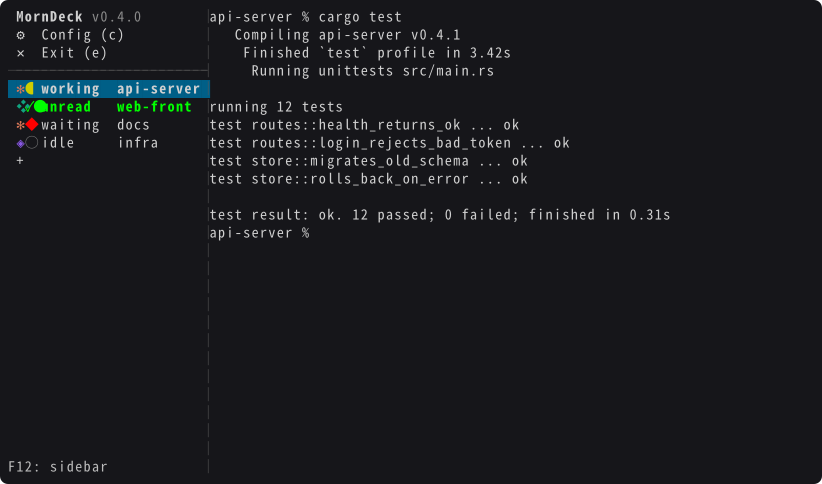

# MornDeck

English | [日本語](README.ja.md)

MornDeck is a tabbed terminal that runs inside your terminal, with a sidebar that shows whether Claude Code, Codex CLI and GitHub Copilot CLI are working, waiting or done. Tabs keep running after you close the terminal.

It runs on macOS 11 or later (Apple Silicon and Intel), on Linux (x86_64 and aarch64), and on Windows 10 (version 2004 or later) and 11 (x64 and arm64), where it runs inside WSL 2 and `mdeck.exe` starts it from Windows.



## Install

### macOS

```bash
brew install --cask tsukumistudio/tap/morndeck
```

Use the tap name: other tools are also called `mdeck`.

### Windows

1. Install WSL 2: run `wsl --install` in an administrator PowerShell and restart ([Microsoft's guide](https://learn.microsoft.com/windows/wsl/install)).
2. Download `MornDeck-<version>-windows-x64.zip` (or `-arm64.zip`) from the [latest release](https://github.com/TsukumiStudio/MornDeck/releases/latest) and unzip it.
3. In PowerShell or Windows Terminal, run `.\mdeck.exe` in that folder. The first run installs the same version into WSL. No PATH setup is needed.

Install claude, codex and copilot inside WSL. winget (`winget install TsukumiStudio.MornDeck`) is under review and does not work yet.

### Linux

```bash
v=<version>; a=$(uname -m)
curl -fLO "https://github.com/TsukumiStudio/MornDeck/releases/download/v$v/mdeck-$v-linux-$a.tar.gz"
curl -fLO "https://github.com/TsukumiStudio/MornDeck/releases/download/v$v/mdeck-$v-linux-$a.tar.gz.sha256"
sha256sum -c "mdeck-$v-linux-$a.tar.gz.sha256"
tar -xzf "mdeck-$v-linux-$a.tar.gz"
install -D -m 755 "mdeck-$v-linux-$a/mdeck" ~/.local/bin/mdeck   # ~/.local/bin must be on PATH
```

## Getting started

1. Run `mdeck`.
2. Press `F12`, then `c` to open the settings ("Config"). Under "Hooks", select the agents you use and press `Enter`.
3. Start `claude` or another agent in a tab.

`F12` opens the menu, `Shift+F12` hides the sidebar, and "+" opens a new tab. Update with "Check for updates" in the settings.

Updating, settings, the API, MCP, webhooks and security are in the [manual](docs/manual.md). For agents that drive MornDeck: [agent guide](docs/agent-guide.md).

## Uninstall

```bash
mdeck uninstall
brew uninstall --cask --zap tsukumistudio/tap/morndeck
```

On Linux, run `mdeck uninstall`, then `rm ~/.local/bin/mdeck` and `rm -r ~/.mdeck`.

## License

[Unlicense](LICENSE). Bundled libraries: [THIRD_PARTY_LICENSES](THIRD_PARTY_LICENSES).

MornDeck is an unofficial tool, not affiliated with Anthropic, OpenAI or GitHub. Claude, Codex and GitHub Copilot are trademarks of their respective owners.
