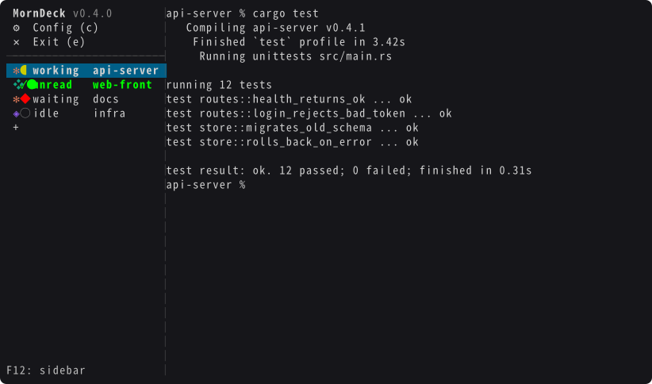

# MornDeck

English | [日本語](README.ja.md)

MornDeck is a tabbed terminal that runs inside your terminal, with a sidebar that tracks AI coding agents. It runs on macOS 11 or later (Apple Silicon and Intel).

The screen, error messages and logs are in Japanese only for now.



## Features

- Open several tabs in one terminal and switch between them from the sidebar.
- Processes keep running after you close the terminal. Run `mdeck` again, even over ssh, to return to the same screen.
- An API and an MCP server let another program open tabs, send text, read the screen and wait for a reply.
- The sidebar shows whether Claude Code, Codex CLI and GitHub Copilot CLI (below: claude, codex, copilot) are working, waiting for input or done, and notifies you when they finish.

## Install

```bash
brew install --cask tsukumistudio/tap/morndeck
```

Other tools are also called `mdeck` (Markdown slide tools on crates.io, npm and PyPI). MornDeck is unrelated to them, so install it with the tap name (`tsukumistudio/tap`). Two commands with the same name cannot be installed together.

Update with `brew upgrade --cask morndeck` or with "更新を確認" (check for updates) in the settings.

After installing, the cask removes the quarantine attribute from `mdeck`. The binary is notarized, but with the attribute left on, macOS stops every update at a first-launch dialog that you cannot see over ssh.

## Getting started

1. Run `mdeck`.
2. Press `F12`, then `c` to open the settings. Under "フック" (hooks), select the agents you use and press `Enter`.
3. Start `claude` or another agent in a tab.

## Keys

`F12` (fn+F12) moves the focus to the sidebar.

| Key | Action |
| --- | --- |
| `↑` `↓` | Select a tab |
| `Enter` | Return to that tab |
| `→` | Tab menu (name, webhook, AutoYes, delete) |
| `c` | Settings |
| `e` | Close the screen (tabs keep running) |
| `F12` | Cancel |

Open a new tab with "+" in the sidebar. The mouse works too: click, right-click and drag.

The settings cover updates, installing and removing hooks, the sidebar width, the usage gauge, the notification sound and popup, and webhooks.

`mdeck kill` stops the server and every tab. The tab list is saved and comes back the next time you run `mdeck`.

## Hooks

MornDeck learns each agent's state through its hooks. Installing them from the settings rewrites these files:

| Agent | File |
| --- | --- |
| claude | `~/.claude/settings.json` |
| codex | `~/.codex/hooks.json` |
| copilot | `~/.copilot/hooks/mdeck.json` (used only by MornDeck) |

- Only MornDeck's hooks are added; other settings are kept. The file is reformatted.
- The content from before the first change is kept as `<file name>.mdeck-bak`.
- When the hook format changes, the server rewrites installed hooks to the new format when it starts.
- The hooks do nothing outside a MornDeck tab.
- To remove them, press `Enter` on the agent's row in the settings, or run `mdeck uninstall`.

## Usage gauge

The bottom of the sidebar shows how much of the weekly limit (claude, codex) and the monthly limit (copilot) you have used. To do this MornDeck reads the following:

| Agent | What it reads | Where it is sent |
| --- | --- | --- |
| claude | The OAuth token in the keychain item `Claude Code-credentials` | `api.anthropic.com/api/oauth/usage`, every 5 minutes |
| copilot | A token from `COPILOT_GITHUB_TOKEN` / `GH_TOKEN` / `GITHUB_TOKEN`, the keychain item `copilot-cli`, or `~/.copilot/config.json` | `api.github.com/copilot_internal/user`, every 5 minutes |
| codex | The session logs in `~/.codex/sessions` | Nowhere |

- Tokens go only to the hosts above. They are not stored or logged.
- Neither API is publicly documented by its vendor, so either may stop working without notice.
- Turn off "使用量のゲージ" (usage gauge) in the settings and MornDeck reads no token or log and calls neither API.

Apart from these two, MornDeck connects out only for "更新を確認" (github.com) and to the webhooks you register. It sends no usage data.

## AutoYes

Turn on AutoYes in a tab's menu and MornDeck answers Yes to Yes / No permission prompts. It does not answer questions or plan approvals.

- It also answers Yes to prompts for deleting files or running `git push`. Turn it on only in tabs whose work you trust.
- It answers only prompts whose options start with `Yes` / `No` in English.

## API

```bash
mdeck api '{"cmd":"open_tab","name":"work","cwd":"/path/to/repo","agent":"claude"}'
mdeck api '{"cmd":"send","tab":"work","text":"fix the tests"}'
```

`tab` is a tab id or name. Arguments marked `?` are optional.

| Command | Arguments | Action |
| --- | --- | --- |
| `list_tabs` | | List tabs |
| `open_tab` | `cwd`, `name?`, `owner?`, `agent?`, `args?`, `run?`, `yolo?`, `auto_yes?`, `wait?`, `timeout_ms?` | Open a tab. `agent` is `claude` (default), `codex` or `copilot`. With `run`, runs that command instead |
| `close_tab` | `tab` or `owner` | Close a tab. With `owner`, closes every tab of that owner |
| `update_tab` | `tab`, `name?`, `owner?`, `auto_yes?` | Change a tab's settings |
| `send` | `tab`, `text`, `wait?`, `request_id?`, `force?`, `timeout_ms?` | Type the text, press Enter and wait for the reply |
| `press_keys` | `tab`, `keys` | Send raw keys |
| `choose` | `tab`, `n`, `wait?`, `timeout_ms?` | Pick an option by number |
| `get_answer` | `tab`, `timeout_ms?` | The current reply and options. With `timeout_ms`, waits until a reply or options appear |
| `get_screen` | `tab` | The text on the screen |
| `subscribe` | | Stream events (tabs opened and closed, state changes, options, AutoYes), one JSON object per line |
| `list_webhooks` | `owner?` | List webhooks |
| `add_webhook` | `url`, `owner?`, `headers?` | Add a webhook |
| `remove_webhook` | `url`, `owner?` | Remove a webhook |
| `test_webhooks` | `owner?` | Send a test event to the webhooks |

`yolo: true` starts the agent with no permission prompts and no sandbox (`claude --dangerously-skip-permissions` and the like). The agent can then run anything, so use it only where damage does not matter.

Commands that wait return this shape:

```json
{"ok": true, "tab": {...}, "state": "done", "seq": 3, "answer": "Fixed.", "timed_out": false}
```

| Key | Meaning |
| --- | --- |
| `state` | `done`: `answer` is the reply. `waiting`: read `question` and `options`, then answer with `choose`. `blocked`: a startup prompt stopped the agent |
| `seq` | A number that goes up with each reply. `send` returns the number its reply will have as `expect_seq` |
| `timed_out` | `true`: call `get_answer` with `timeout_ms` to keep waiting |

On failure a command returns `{"ok": false, "error": {"code": "...", "message": "..."}}`. `code` is one of `invalid` (bad arguments), `no_such_tab`, `busy` (the agent is working), `not_ready` (the agent is starting), `not_found`, `failed`, `unknown_cmd`.

While the version is 0.x, the arguments and results of the API and MCP may change. Changes are listed in the [CHANGELOG](CHANGELOG.md).

## MCP

The tools are the API commands (except `subscribe`).

```json
{"mcpServers": {"mdeck": {"command": "/opt/homebrew/bin/mdeck", "args": ["mcp"]}}}
```

On an Intel Mac the path is `/usr/local/bin/mdeck`.

From another machine, start it over ssh:

```json
{"mcpServers": {"mdeck": {"command": "ssh", "args": ["<user>@<host>", "/opt/homebrew/bin/mdeck", "mcp"]}}}
```

A key that can use MCP can run anything on that Mac (see [Security](#security)). To limit the key to `mdeck mcp`, prefix it with `command=` in `~/.ssh/authorized_keys` on the Mac:

```
restrict,command="/opt/homebrew/bin/mdeck mcp" ssh-ed25519 <public key>
```

## Webhook

MornDeck POSTs JSON to the registered URLs at these moments. Failed deliveries are not retried.

| When | JSON |
| --- | --- |
| The agent finished a reply | `{"event": "state", "state": "done", "tab": {...}, "answer": "...", "seq": 3}` |
| The agent showed options | `{"event": "choices", "tab": {...}, "question": {...}, "options": [{"n": 1, "label": "Yes", "selected": true}]}` |
| AutoYes answered | `{"event": "auto_yes", "tab": {...}, "label": "Yes", "options": [...]}` |

```bash
mdeck api '{"cmd":"add_webhook","owner":"mytool","url":"https://example.com/hook","headers":{"Authorization":"Bearer ..."}}'
```

With `owner`, the webhook receives only the events of tabs with the same `owner`.

## Security

- MornDeck listens only on `~/.mdeck/mdeck.sock`, a Unix socket that only you can read and write. It opens no network port.
- Anyone who can use this socket, the API or MCP can run anything on the Mac as you (`run` in `open_tab`, `send`, `press_keys`). An ssh key that may use MCP is as powerful as a shell.
- Webhooks send the reply text to the receiver. To an `http://` URL, the text and the header secrets travel unencrypted.
- `~/.mdeck/events.log` records API calls, replies and hook payloads (the first 300 characters of each). Webhook header values and the last part of webhook URLs are not recorded.
- To report a vulnerability, see [SECURITY.md](SECURITY.md).

## Uninstall

```bash
mdeck uninstall
brew uninstall --cask --zap tsukumistudio/tap/morndeck
```

`mdeck uninstall` removes the hooks and stops the server. `--zap` deletes `~/.mdeck/`. The `.mdeck-bak` copies of your settings from before the hooks are kept.

## Files

Settings, tabs and logs are in `~/.mdeck/`.

## Build from source

Requires Rust 1.88 or later.

```bash
cargo build --release   # target/release/mdeck
zsh build.sh            # dist/MornDeck.app (ad-hoc signed)
```

Released builds are signed with a Developer ID and notarized by Apple.

## License

[Unlicense](LICENSE)

The licenses of the bundled libraries are in [THIRD_PARTY_LICENSES](THIRD_PARTY_LICENSES); `mdeck --licenses` prints them.

MornDeck is an unofficial tool, not affiliated with Anthropic, OpenAI or GitHub. Claude, Codex and GitHub Copilot are trademarks of their respective owners.
